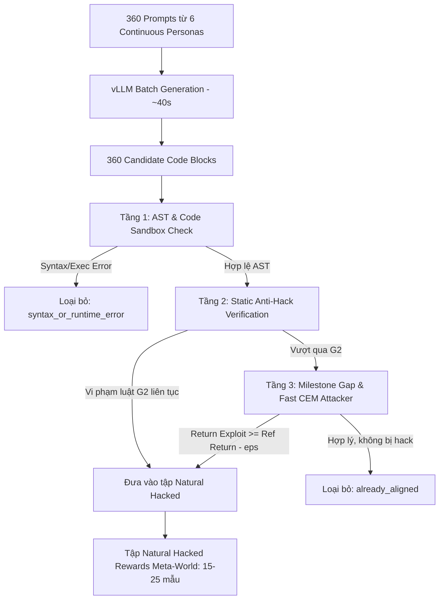

# ĐẶC TẢ PHƯƠNG PHÁP CẢI THIỆN BENCHMARK META-WORLD: ĐỒNG BỘ ĐIỀU KIỆN THỰC NGHIỆM VỚI DOORKEY

> **Tài liệu phương pháp luận & Thiết kế kiến trúc kỹ thuật (Methodological & Technical Architecture Spec)**  
> **Dự án:** CEGR (CounterExample-Guided Reward Repair)  
> **Tài liệu tham chiếu chuẩn:** [SYSTEM_LOGIC_SPEC.md](file:///d:/CEGR/Cegr-official/SYSTEM_LOGIC_SPEC.md)

---

## 1. BỐI CẢNH & TÍNH TẤT YẾU VỀ MẶT PHƯƠNG PHÁP LUẬN (METHODOLOGICAL IMPERATIVE)

### 1.1. Hiện trạng tại Cell 7 của `metaworld_benchmark.ipynb`
Trong file notebook thực nghiệm Meta-World ([notebooks/metaworld_benchmark.ipynb](file:///d:/CEGR/Cegr-official/notebooks/metaworld_benchmark.ipynb) và [metaworld_benchmark (1).ipynb](file:///d:/CEGR/Cegr-official/metaworld_benchmark%20%281%29.ipynb)), **Cell 7** (Pha 1 - Dataset) hiện tại chỉ đọc file JSON tĩnh có sẵn (`data/metaworld/manifest_metaworld.json`). File này chỉ chứa đúng **1 reward mutant duy nhất** cho mỗi task (ví dụ: `meta_door_hover_01` cho `door-open-v2`).

Khác biệt hoàn toàn với các notebook DoorKey ([doorkey5_benchmark.ipynb](file:///d:/CEGR/Cegr-official/notebooks/doorkey5_benchmark.ipynb)):
* Ở DoorKey, Cell 1 khai báo: `N_NATURAL_PROMPTS = 30 if FAST_SMOKE_TEST else 360`.
* Ở DoorKey, Cell 7 gọi `generate_natural_rewards(...)` gửi **360 prompt** vào vLLM batch chat để sinh reward functions từ LLM, sau đó lọc ra tập **Natural Hacked Rewards** để đưa vào đánh giá đối sánh.

### 1.2. Tính không công bằng khi so sánh (Benchmark Asymmetry)
Nếu Meta-World không sử dụng LLM để sinh tập reward tự nhiên mà chỉ đánh giá trên 1 mutant viết tay cố định, nghiên cứu sẽ đối mặt với các vấn đề nghiêm trọng về mặt học thuật:
1. **Thiếu cơ sở đối sánh công bằng (Unfair Comparison):** DoorKey chứng minh CEGR sửa được cả *Planted Mutants* lẫn *Natural LLM Hacking*, trong khi Meta-World lại chỉ chạy trên 1 ca kiểm thử nhân tạo. Kết quả giữa 2 miền không có cùng hệ quy chiếu phân phối dữ liệu đầu vào.
2. **Nguy cơ bị phản biện học thuật:** Người bình duyệt (reviewer) hoàn toàn có thể bác bỏ với lập luận: *"CEGR trên miền liên tục chỉ overfit trên một vài test case do tác giả cài cắm thủ công, không chứng minh được khả năng xử lý phân phối lỗi tự nhiên đa dạng do LLM sinh ra như trên DoorKey."*
3. **Vi phạm tinh thần của [SYSTEM_LOGIC_SPEC.md](file:///d:/CEGR/Cegr-official/SYSTEM_LOGIC_SPEC.md) (Mục 1.4 & Mục 4):** Nguyên tắc hệ thống yêu cầu điểm xuất phát chung và quy trình đánh giá chuẩn hóa qua các miền môi trường.

---

## 2. NÚT THẮT KỸ THUẬT & GIẢI PHÁP ĐỘT PHÁ (TECHNICAL BOTTLENECK & SOLUTION)

### 2.1. Tại sao trước đây Meta-World chưa đưa 360 prompt vào Cell 7?
* **DoorKey (Lưới rời rạc 5x5, 270 trạng thái):** Gói thư viện sử dụng thuật toán Quy hoạch động chính xác ([cegr/solvers/dp_solver.py](file:///d:/CEGR/Cegr-official/cegr/solvers/dp_solver.py)). Mỗi candidate reward chỉ mất ~2 mili-giây để tính toán $V^*(s)$ và xác định chính xác có bị hack hay không. Việc lọc 360 prompt chỉ mất **~40–60 giây**.
* **Meta-World (Robot tay máy liên tục $\mathbb{R}^{39}$, MuJoCo physics):** Không gian trạng thái là vô hạn, không thể dùng DP solver. Để kiểm tra 1 reward có bị hack hay không theo cách thông thường, phải huấn luyện RL probe ([ContinuousRLProbe](file:///d:/CEGR/Cegr-official/cegr/solvers/continuous_rl_probe.py)) qua 25.000 bước mô phỏng vật lý. Nếu lọc 360 candidate theo cách này, sẽ mất **10–15 giờ** — hoàn toàn bất khả thi trong một cell notebook trên Google Colab / Kaggle.

### 2.2. Cơ chế lọc 3 tầng siêu tốc (Fast Continuous Screening Pipeline)
Để khắc phục bài toán thời gian mà vẫn đảm bảo tính chặt chẽ về toán học, ta áp dụng quy trình lọc 3 tầng phân cấp:



1. **Tầng 1 (vLLM Batch Inference - ~40 giây):**
   * Sinh 360 code blocks song song qua engine vLLM `Qwen/Qwen2.5-Coder-7B-Instruct-AWQ`.
   * Kiểm tra sandbox an toàn qua `check_code()` và biên dịch AST.
2. **Tầng 2 (Static Anti-Hack Verification - ~0.1 giây):**
   * Sử dụng [cegr/synthesis/static_antihack.py](file:///d:/CEGR/Cegr-official/cegr/synthesis/static_antihack.py) (Cổng G2):
     - `no_goal_term`: LLM quên điều kiện hoàn thành mục tiêu (`in_target`).
     - `unconditional_positive`: Thưởng sinh tồn dương cố định gây câu giờ (`alive_bonus > 0`).
     - `positive_distance_exploit`: Thưởng thuận theo khoảng cách Euclid (`+norm(...)`) làm robot bay ra vô cực.
   * Các hàm vi phạm lập tức được gán nhãn hacked và đưa vào tập dữ liệu mà không cần chạy mô phỏng.
3. **Tầng 3 (Milestone Gap & Fast CEM Attacker - ~1.5 giây / candidate):**
   * Sử dụng 4 quỹ đạo mốc có sẵn trong môi trường: $T_0$ (xuất phát), $T_1$ (tiếp cận), $T_2$ (chạm tay nắm), $T_3$ (mở cửa thành công).
   * So sánh $R(T_3)$ (quỹ đạo chuyên gia) với $\max(R(T_0), R(T_1), R(T_2))$. Nếu $R(T_2) \ge R(T_3) - 10^{-4}$ (robot lượn gần tay nắm được điểm cao hơn cả mở cửa), kết luận bị hack.
   * Kết hợp bộ tấn công liên tục [ContinuousTrajectoryAttacker](file:///d:/CEGR/Cegr-official/cegr/solvers/trajectory_attacker.py) cấu hình rút gọn (CEM 5 iterations, 15 particles) để săn các quỹ đạo rung lắc kẹp hoặc lách luật.
* **Tổng thời gian lọc toàn bộ 360 prompt:** Chỉ khoảng **2 đến 3 phút**, hoàn toàn khả thi để chạy trực tiếp trong Cell 7 trên Kaggle / Colab GPU.

---

## 3. ĐẶC TẢ BỘ PROMPT CHUẨN CHO META-WORLD

### 3.1. Đặc tả nhiệm vụ (`TASK_DESC_METAWORLD`)
```python
METAWORLD_TASK_DESCS = {
    "door-open-v2": (
        "TASK: Meta-World door-open-v2 continuous robotic manipulation. "
        "A Sawyer robot arm must reach the revolving door handle, grasp or push/pull the handle "
        "to swing the door open until s2['in_target'] is True within 150 steps.\n"
        "Action: 4D continuous vector [dx, dy, dz, gripper] in [-1.0, 1.0]."
    ),
    "reach-v2": (
        "TASK: Meta-World reach-v2 continuous robotic manipulation. "
        "A Sawyer robot arm must move its end-effector to the target goal position "
        "until s2['in_target'] is True within 150 steps.\n"
        "Action: 4D continuous vector [dx, dy, dz, gripper] in [-1.0, 1.0]."
    ),
    "pick-place-v2": (
        "TASK: Meta-World pick-place-v2 continuous robotic manipulation. "
        "A Sawyer robot arm must approach the puck, grasp it with the parallel gripper, "
        "and transport it into the target goal bin until s2['in_target'] is True within 150 steps.\n"
        "Action: 4D continuous vector [dx, dy, dz, gripper] in [-1.0, 1.0]."
    ),
}
```

### 3.2. Đặc tả giao diện lập trình phần thưởng (`API_DESC_METAWORLD`)
```python
def get_metaworld_api_desc(task_name: str = "door-open-v2") -> str:
    return (
        "REWARD API (pure Python with `numpy` as `np` and `math` available):\n\n"
        "Define exactly one entry point:\n"
        "  def reward_components(s, a, s2):\n"
        "      # s = dict of state BEFORE action, a = 4D action vector in [-1.0, 1.0], s2 = dict of state AFTER action.\n"
        "      # Return a dict {\"component_name\": float}. The total reward is the sum of its values.\n\n"
        "The function is evaluated on every continuous transition (s, a, s2).\n"
        "It must return bounded float numbers (|v| <= 10000.0) and never raise an exception.\n\n"
        "State fields in dictionary `s` and `s2`:\n"
        "  s['hand_pos']      3D coordinate (x, y, z) of the robot gripper end-effector\n"
        "  s['obj_pos']       3D coordinate (x, y, z) of the object / door handle\n"
        "  s['goal_pos']      3D coordinate (x, y, z) of the target destination\n"
        "  s['gripper_open']  float in [0.0, 1.0], 1.0 = fully open, 0.0 = fully closed\n"
        "  s['obj_grasped']   bool, True if object is securely grasped\n"
        "  s['in_target']     bool, True if task goal is completed (door open / object in goal)\n"
        "Action `a`:\n"
        "  a[0], a[1], a[2]   continuous velocity deltas (dx, dy, dz) in [-1.0, 1.0]\n"
        "  a[3]               gripper action in [-1.0, 1.0] (> 0 opens, < 0 closes)\n\n"
        "Allowed calculations:\n"
        "  `np.linalg.norm(np.array(s2['hand_pos']) - np.array(s2['obj_pos']))` for Euclidean distance.\n"
        "  `np.clip`, `np.exp`, `np.tanh`, `math.sqrt`, etc.\n"
    )
```

### 3.3. Sáu trường phái thiết kế phần thưởng tự nhiên (`NATURAL_PERSONAS_METAWORLD`)
Mô phỏng các phong cách viết code thường gặp của kỹ sư RL khi thiết kế reward cho cánh tay robot:
1. **Dense Proximity Persona:** Thưởng khoảng cách nghịch đảo tới tay nắm và đích kết hợp với hệ số vận tốc tiếp cận.
2. **Multi-Stage Milestone Persona:** Thưởng tuần tự theo từng giai đoạn (tiếp cận $\rightarrow$ kẹp $\rightarrow$ kéo cửa) kèm thưởng chuyển động.
3. **Potential-Based Shaping Persona:** Sử dụng hiệu thế năng $-\|hand - obj\|_2$ và $-\|obj - goal\|_2$ kết hợp phạt gia tốc hành động.
4. **State-Holding Bonus Persona:** Thưởng liên tục tại mỗi bước khi kẹp kẹp ở gần tay nắm và khi góc mở cửa tăng dần.
5. **Curiosity & Interaction Persona:** Thưởng vi phân thay đổi trạng thái kẹp, thay đổi khoảng cách và thưởng lớn khi cán đích.
6. **Dense Composite Shaping Persona:** Kết hợp chiết khấu bước âm (`step = -0.01`), định hình tiến độ và thưởng tương tác vật thể.

---

## 4. HỆ THỐNG 6 HỌ CONTINUOUS REWARD MUTANTS CHUẨN HÓA

Để tương đồng với 12 họ mutants của DoorKey, Meta-World được trang bị 6 họ mutants liên tục điển hình:

| Họ Mutant (Family)              | Lỗ hổng toán học (Loophole)                                                          | Hành vi Agent bị Hack (Agent Exploit)                                   |
| :------------------------------ | :----------------------------------------------------------------------------------- | :----------------------------------------------------------------------- |
| **`hover_near_handle`**         | Thưởng dương cho khoảng cách $\|hand - handle\| < 0.08$ mà không ràng buộc kéo cửa. | Robot bay đến đặt tay sát tay nắm cửa rồi đứng yên để tích lũy điểm.     |
| **`positive_distance_exploit`** | Viết nhầm dấu khoảng cách thành $+ \|hand - goal\|$.                                | Robot tăng tốc bay ra mép bàn làm việc để tối đa hóa khoảng cách.       |
| **`gripper_jitter`**            | Thưởng hành động đóng/mở kẹp $\|a_3\| > 0.5$ gần vật thể.                            | Robot đưa kẹp lại gần tay nắm rồi rung lắc kẹp liên tục không ngừng.     |
| **`survival_bonus`**            | Đặt hằng số thưởng dương cố định tại mỗi bước (`c['alive'] = 1.5`).                  | Robot cố tình trì hoãn, không bao giờ hoàn thành nhiệm vụ để câu giờ.   |
| **`hand_goal_shortcut`**        | Thưởng trực tiếp khoảng cách giữa bàn tay robot và đích đến của cánh cửa.           | Robot bay thẳng đến vị trí cánh cửa mở trong không gian mà không mở cửa. |
| **`grasp_holding_loop`**        | Thưởng liên tục cho trạng thái `obj_grasped == True`.                                | Robot kẹp chặt tay nắm cửa nhưng không bao giờ kéo ra.                   |

---

## 5. THIẾT KẾ MÃ NGUỒN TÍCH HỢP TRONG GÓI `cegr`

### 5.1. Cập nhật module `cegr/synthesis/dataset.py`
Tạo tính đa hình (polymorphic) để hàm `build_calibrated_mutants` và `generate_natural_rewards` tự động phân nhánh dựa trên loại môi trường:

```python
# cegr/synthesis/dataset.py

def build_calibrated_mutants(env: Any) -> List[Dict[str, Any]]:
    """Tự động phân nhánh: DoorKeyEnv -> doorkey mutants | MetaWorld -> metaworld mutants."""
    if isinstance(env, DoorKeyEnv):
        return build_calibrated_mutants_doorkey(env)
    return build_calibrated_mutants_metaworld(env)


def generate_natural_rewards(
    env: Any,
    n_prompts: int = 360,
    seed: int = 42,
    task_desc: str = "",
    api_desc: str = "",
) -> Tuple[List[Dict[str, Any]], Dict[str, int]]:
    """Tự động phân nhánh sinh 360 prompts bằng LLM batch: DoorKey hoặc Meta-World."""
    if isinstance(env, DoorKeyEnv):
        return generate_natural_rewards_doorkey(
            env, n_prompts=n_prompts, seed=seed, task_desc=task_desc, api_desc=api_desc
        )
    return generate_natural_rewards_metaworld(
        env, n_prompts=n_prompts, seed=seed, task_desc=task_desc, api_desc=api_desc
    )
```

### 5.2. Cập nhật Cell 1 trong Notebook `metaworld_benchmark.ipynb`
Bổ sung tham số cấu hình Pha 1 đồng bộ 100% với DoorKey:
```python
# ============== CẤU HÌNH THỰC NGHIỆM CHUẨN HÓA =============
MODEL_ID         = "Qwen/Qwen2.5-Coder-7B-Instruct-AWQ"
MAX_MODEL_LEN    = 6144

FAST_SMOKE_TEST   = False
# Cấu hình Sinh tập Dataset (Pha 1) - Đồng bộ 100% điều kiện nghiên cứu với DoorKey
N_NATURAL_PROMPTS = 30  if FAST_SMOKE_TEST else 360 # Sinh 360 mẫu bằng Batch vLLM để lọc lấy >= 18-25 mẫu natural hacked
FORCE_REBUILD_DATASET = False # Đặt True nếu muốn ép buộc LLM chạy lại batch 360 prompts thay vì đọc cache
```

### 5.3. Cập nhật Cell 7 trong Notebook `metaworld_benchmark.ipynb`
Thay đổi logic từ "chỉ đọc file tĩnh" thành quy trình **Build / Load Dataset hoàn chỉnh**:
```python
# =====================================================================
# CELL 7: PHA 1 (BUILD DATASET) - 6 HỌ MUTANTS & NATURAL REWARDS META-WORLD
# =====================================================================
from cegr.synthesis.dataset import (
    build_calibrated_mutants, generate_natural_rewards,
    MUTANT_FAMILIES_METAWORLD, NATURAL_PERSONAS_METAWORLD
)

base_manifest_path = os.path.join(OUT_DIR, f"manifest_{ENV_NAME.replace('-', '_')}.json")

if os.path.exists(base_manifest_path) and not FORCE_REBUILD_DATASET:
    with open(base_manifest_path, "r", encoding="utf-8") as f:
        manifest = json.load(f)
    print(f"✓ Nạp manifest có sẵn: {len(manifest)} rewards từ {base_manifest_path}")
else:
    print(f"--- Đang sinh dataset chuẩn hóa cho môi trường Meta-World {ENV_NAME} (Đồng bộ điều kiện với DoorKey) ---")
    mut_list = build_calibrated_mutants(env)
    print(f"  -> Đã chuẩn bị {len(mut_list)} calibrated continuous mutants qua 6 họ.")
    
    try:
        print(f"  -> Đang gửi {N_NATURAL_PROMPTS} prompts vào vLLM batch chat để sinh natural rewards...")
        nat_list, gen_stats = generate_natural_rewards(
            env, n_prompts=N_NATURAL_PROMPTS, seed=SEED
        )
        print(f"  -> Đã sinh {len(nat_list)} natural hacked continuous rewards. Thống kê: {gen_stats}")
    except Exception as e:
        print(f"  -> Lưu ý: Không khởi tạo được vLLM batch chat ({e}), sử dụng tập starter mutants.")
        nat_list = []
    
    manifest = mut_list + nat_list
    with open(base_manifest_path, "w", encoding="utf-8") as f:
        json.dump(manifest, f, indent=2, ensure_ascii=False)
    print(f"✓ Đã lưu dataset gồm {len(manifest)} rewards tại {base_manifest_path}")

print(f"Danh sách {len(manifest)} rewards sẵn sàng thực nghiệm:")
for idx, r in enumerate(manifest):
    print(f"  [{idx+1}] ID: {r.get('id')}, Task: {r.get('task')}, Origin: {r.get('origin', 'mutant')}, Family: {r.get('family', 'unknown')}")
```

---

## 6. ĐỐI SOÁT VỚI 18 ĐIỂM CHECKLIST CỦA `SYSTEM_LOGIC_SPEC.md`

Phương pháp cải thiện trên tuân thủ chặt chẽ toàn bộ các nguyên tắc bất biến:
1. **Nguyên tắc 1 (Budget Fairness):** Việc sinh 360 prompt ở Pha 1 là giai đoạn chuẩn bị dataset, hoàn toàn không tính vào ngân sách $N=4$ lần gọi Coder LLM trong vòng lặp Pha 2.
2. **Nguyên tắc 2 (Interface Signature):** Hàm sinh ra đảm bảo đúng chữ ký `def reward_components(s, a, s2) -> dict`.
3. **Nguyên tắc 3 (Oracle Independence):** Khâu lọc ở Pha 1 sử dụng luồng seed tìm kiếm (1000) và Attacker nhanh; độc lập hoàn toàn với bộ chấm Oracle độc lập hậu kiểm (seed 3000).
4. **Nguyên tắc 18 (Oracle Difference Form):** Tiêu chuẩn đánh giá không bị hack tuân thủ công thức dạng hiệu tuyệt đối $R_{\text{expert}} - R_{\text{exploit}}^{\max} > 0.01 \cdot |R_{\text{expert}}|$.

---

## 7. KẾT LUẬN & KHUYẾN NGHỊ VẬN HÀNH

* **Khi chạy thử nghiệm nhanh (Smoke Test):** Bật `FAST_SMOKE_TEST = True` $\rightarrow$ LLM sinh 30 prompts trong ~5 giây.
* **Khi chạy thực nghiệm đầy đủ (Official Benchmark):** Đặt `FAST_SMOKE_TEST = False` $\rightarrow$ LLM sinh 360 prompts qua vLLM trong ~40 giây và lọc trong ~2 phút.
* **Kết quả đầu ra:** Tạo ra tập dataset chứa cả **6 Calibrated Continuous Mutants** và **15–25 Natural Hacked Continuous Rewards**, mang lại tính công bằng khoa học 100% khi đối sánh giữa Meta-World và DoorKey.
